Velero copies a Kubernetes cluster into a bucket and can restore that copy back into the cluster. A backup takes Deployments, Pods, ConfigMaps, and disks. The bucket is a Backup Storage Location.

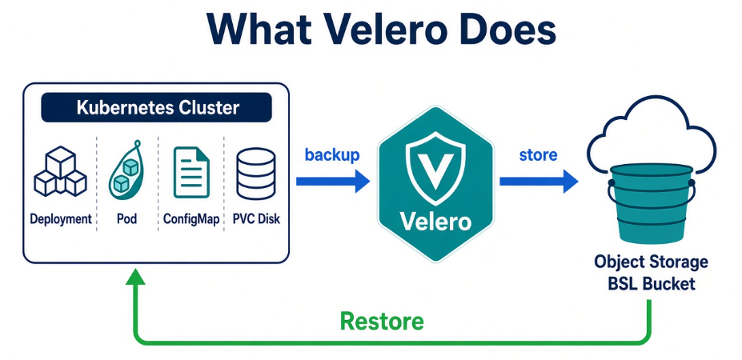

Velero stores a backup in a bucket and can restore it to the cluster.

A backup is the copy you use after a workload or a namespace is gone. A restore brings the objects back. It does not promise that the application stays up the whole time.

Headlamp is an extensible Kubernetes web UI. The Velero plugin shows those Schedules, Backups, Restores, and storage locations in Headlamp, so you can see what is protected and whether the last run succeeded without leaving the UI.

## Why do we need Velero

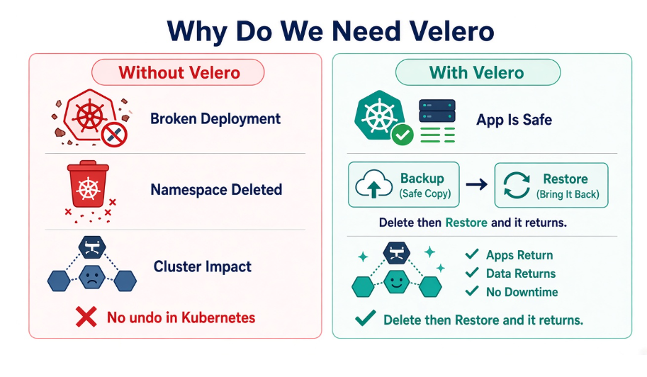

A backup is the copy you use after a workload or a namespace is gone. A restore brings the objects back. It does not promise that the application stays up the whole time.

## Visual context helps you follow a backup without a stack of CLI commands

Checking a backup often means moving across several related objects. You might start from a Deployment, look for a Schedule that includes it, open the latest Backup, check the phase, then look at the storage location to see if the bucket is available. All of that is possible with `kubectl` and the Velero CLI, but it becomes fragmented very quickly.

The Velero plugin for Headlamp keeps those resources in one UI. Instead of reconstructing the links from names and labels, you can move from a workload to its Schedule, from that Schedule to its Backup, and from the Backup to the storage location.

Velero introduces its own resources on top of core Kubernetes objects:

Schedule

Decides what to include and when to run. The schedule is a cron expression plus a template for the Backup.

Backup

One saved point in time. It records the phase, the namespaces it included, and any error Velero reported.

Restore

Rebuilds objects from a named Backup.

Backup Storage Location

The bucket Velero writes to. If this location is Unavailable, new backups fail even when a Schedule still creates Backup objects.

The plugin surfaces these resources in Headlamp, with list and detail views under a Velero section in the sidebar.

## Coverage: is this workload in a schedule?

The question usually starts on the workload, not on a Velero list. Open a Deployment, StatefulSet, or PersistentVolumeClaim and the plugin adds a coverage panel. The panel lists the Schedules whose template includes that object, with the cron expression, the next run, and the status of the latest backup.

A Namespace page answers a smaller question: which Schedules target this namespace. It does not evaluate label selectors against every live object inside the namespace. If Velero is not installed, the panel says so instead of showing an empty table.

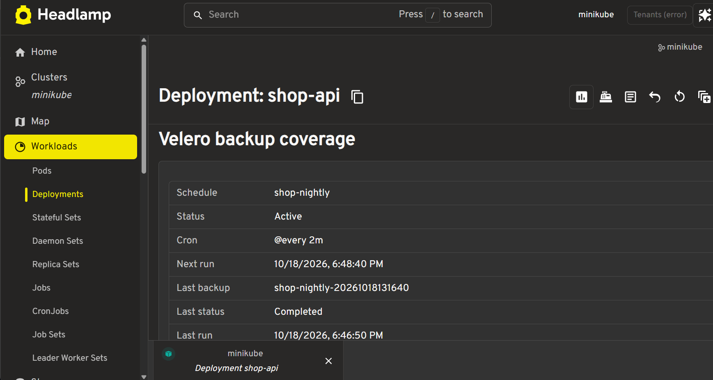

## Schedules, Backups, and Restores: what happened last

The sidebar is where you go after the coverage panel. A Schedule shows whether it is active or paused, when it runs next, and which Backup it last created. A Backup shows its phase, whether a Schedule or a person started it, and which namespaces it included. A Restore shows the Backup it came from, how far it got, and its errors and warnings.

The detail page is the one you want when a run looks wrong. A failed Backup shows the failure reason, validation errors, and status conditions when Velero recorded them. A completed Backup links to the storage location it used.

From the list pages you can create a Backup, a Restore, or a Schedule. On a Schedule you can pause it and unpause it. Those buttons stay hidden until Kubernetes confirms that your user is allowed to create or patch the object.

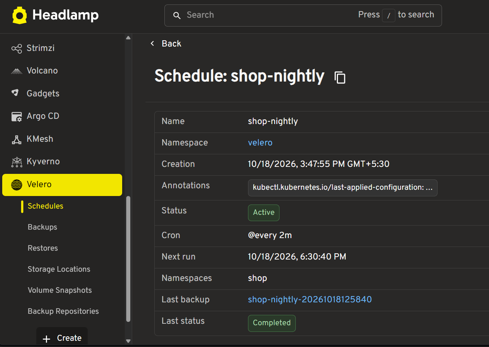

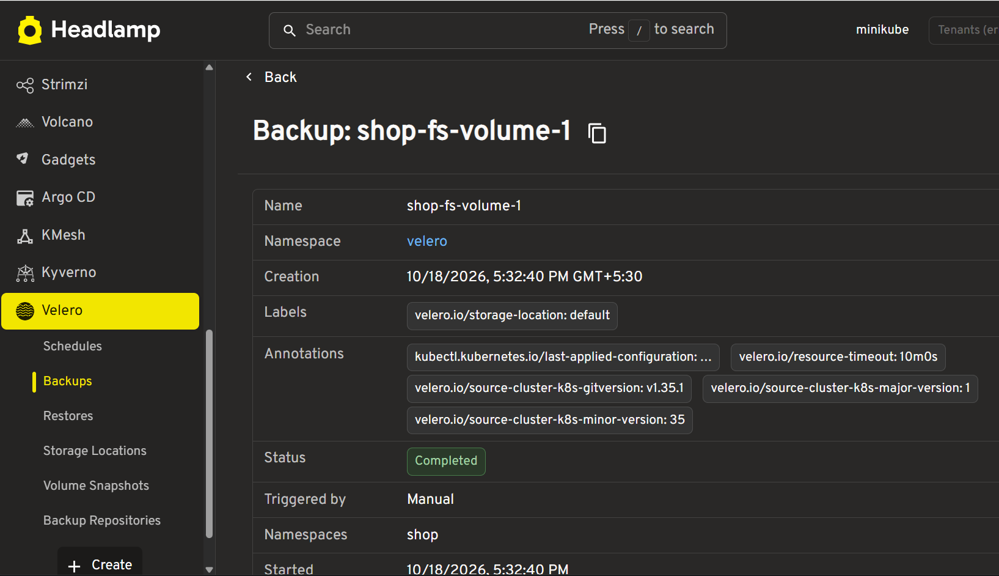

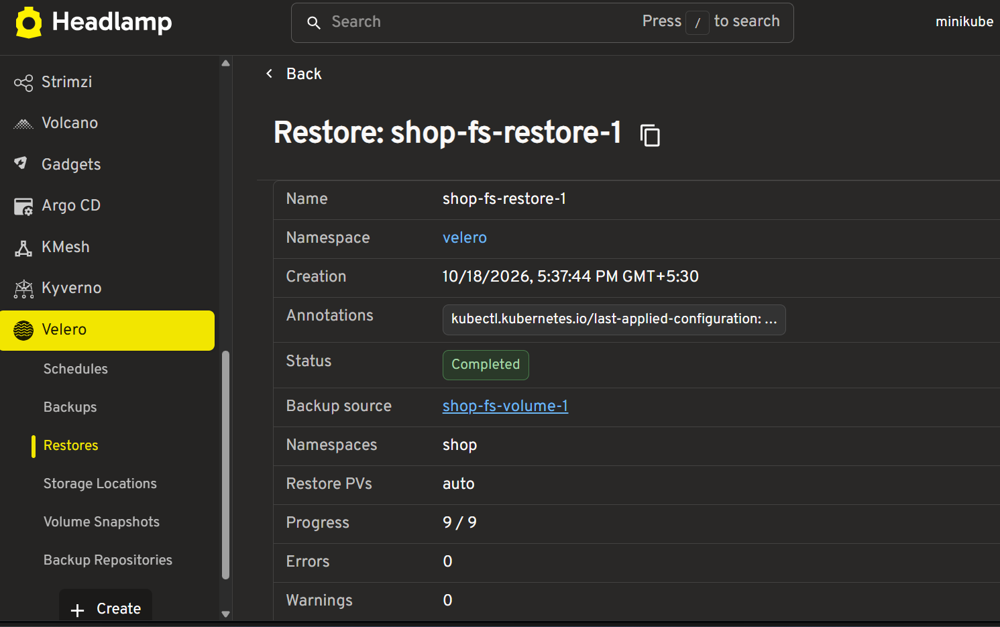

## Storage: where the data went

A Backup Storage Location page shows the provider, the bucket, the access mode, and whether the location is Available or Unavailable. Open it when backups are failing before they copy anything.

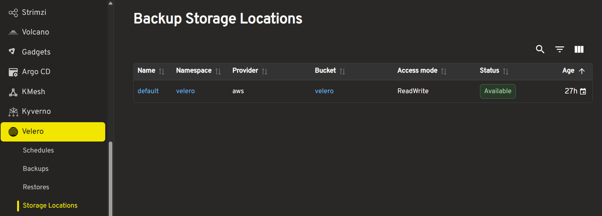

Volume data is a separate trail. When Velero copied files from a pod volume, the Backup page lists PodVolumeBackup rows. When it moved a CSI snapshot into the bucket, it lists DataUpload rows. A Restore lists the matching PodVolumeRestore and DataDownload rows. Those tables stay empty when the backup saved only Kubernetes object manifests.

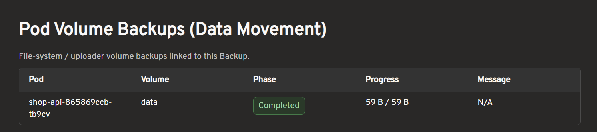

Files copied from a pod volume

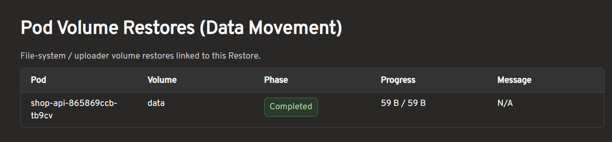

Files written back during a restore

## Overview: is the cluster healthy right now?

Velero → Overview counts Backups and Restores that completed, failed, or are still running. It groups Schedules into active, paused, and failed validation, and it lists storage locations in the same view. Recent failures link straight to the detail page.

This is the page to open when you want one picture of backup health, rather than a pass through every list.

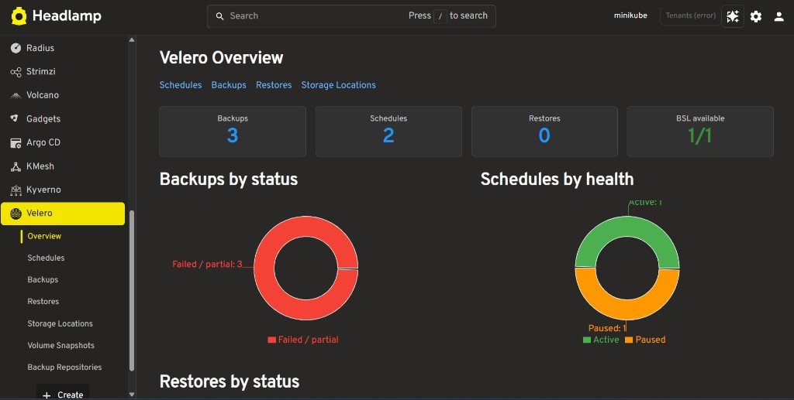

## Map view: schedules, backups, restores, and storage in one place

The map view shows how Velero resources are connected. Instead of inspecting each resource separately, you can see a Schedule, the Backups it created, the Restores that used them, and the storage location they share.

A line labeled creates joins a Schedule to a Backup. A line labeled stores joins a Backup or a Schedule to its storage location. A line labeled restores joins a Backup to a Restore. Green means success. Orange means a warning, such as a paused Schedule or a backup that is still running. A red exclamation mark means the object failed, or the storage location is Unavailable.

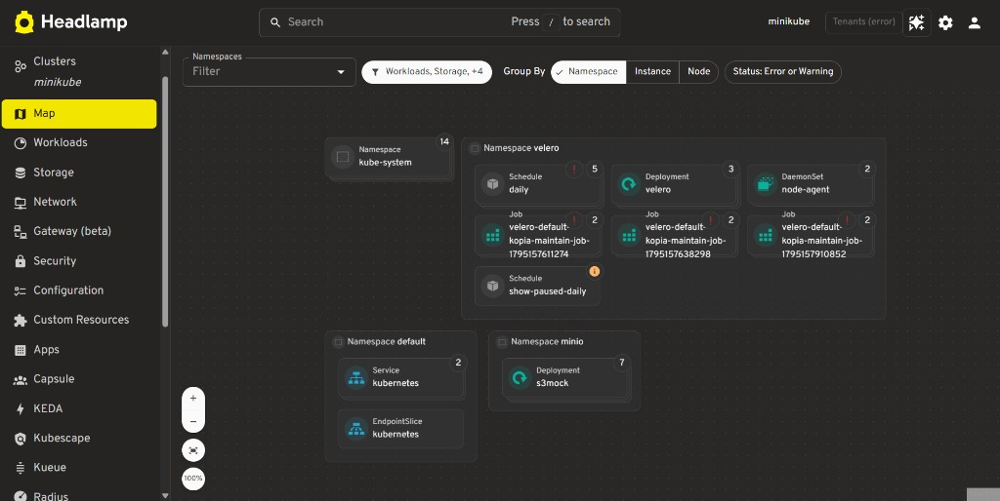

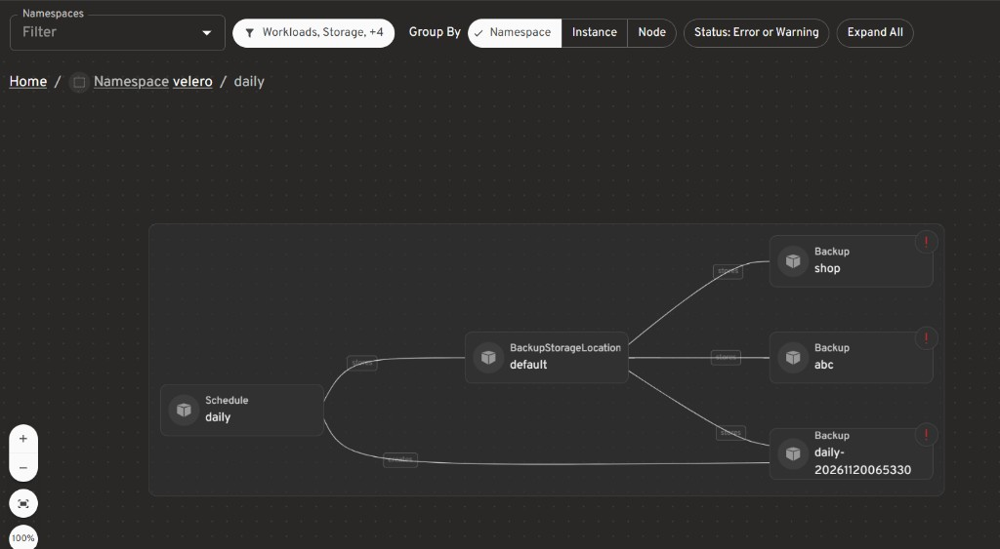

Schedule daily stores its backups in the default location. The red marks are backups that failed.

## Why use this alongside CLI tools

The plugin is not trying to replace `kubectl` or the Velero CLI. Those remain the right tools for scripting, credentials, and raw object inspection. What the plugin improves is the interactive check: finding the Schedule that covers a workload, reading the last Backup's phase, and following that Backup to its storage location without switching tools for every step.

## Try it and share feedback

To try the plugin:

1. Install Headlamp.
2. Open the Plugin Catalog from the Headlamp UI.
3. Search for Velero.
4. Install the Velero plugin.
5. Connect Headlamp to a Kubernetes cluster where Velero is already installed.

If you have ideas, feature requests, or bug reports, open an issue in the Headlamp plugins repository. Feedback from people who run Velero will help shape what comes next.
