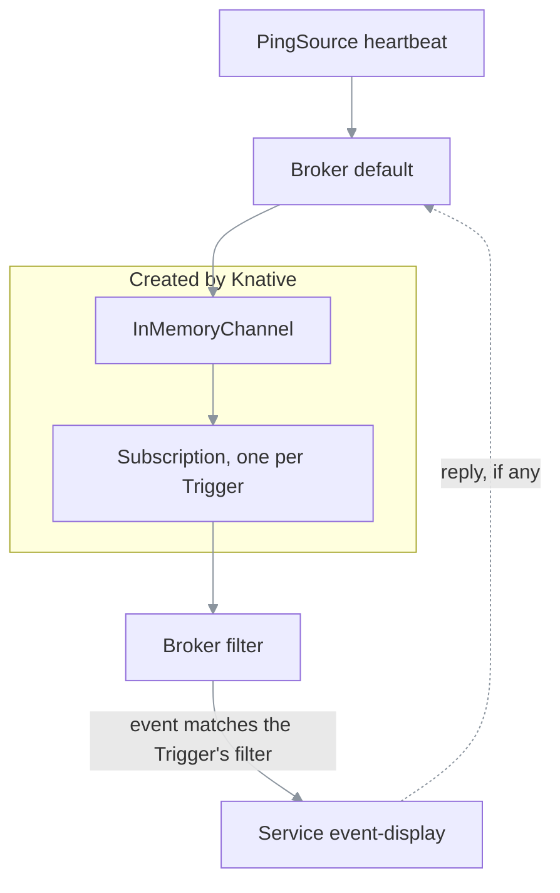
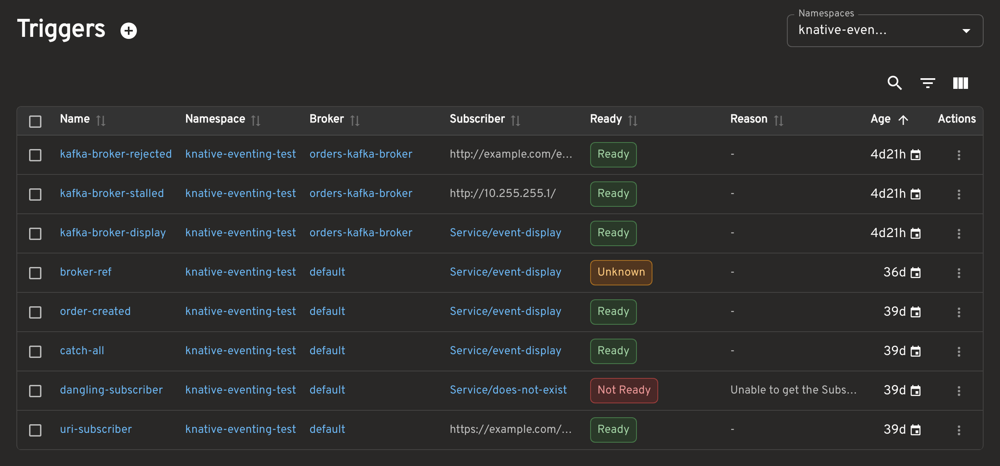
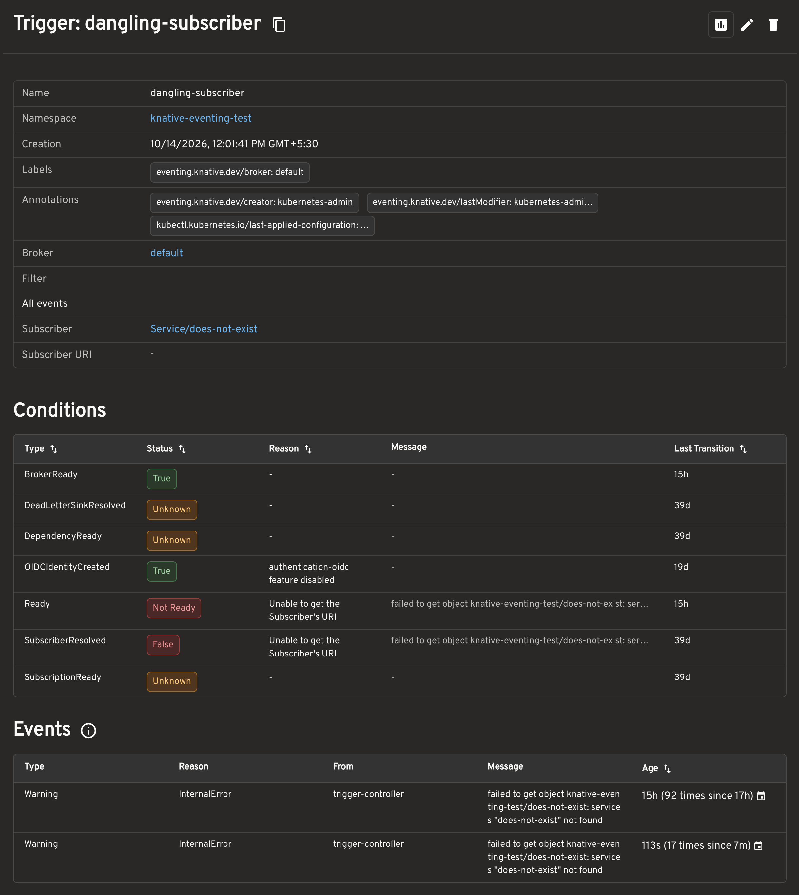
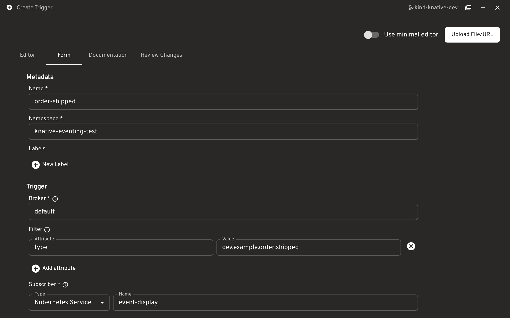
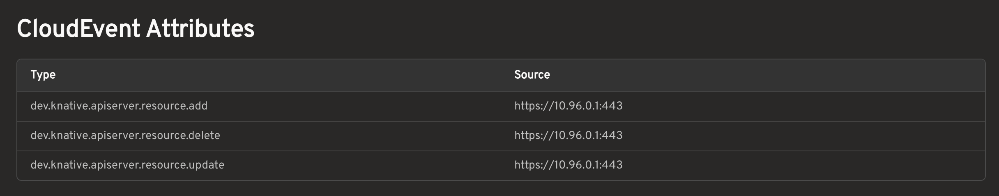
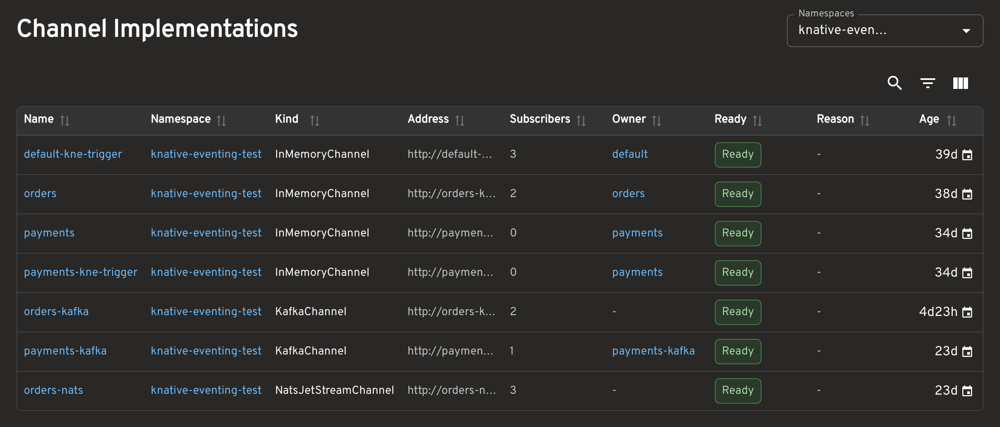
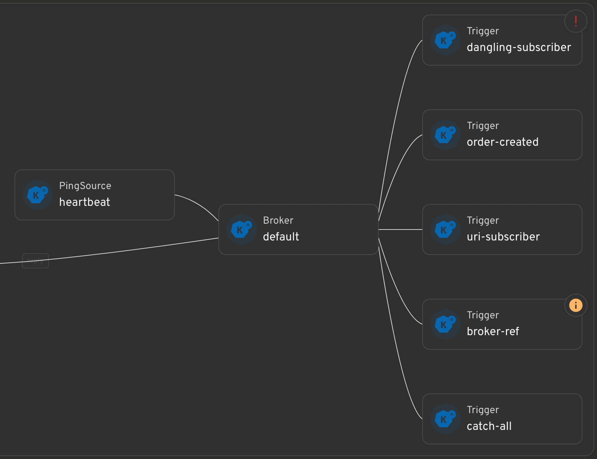
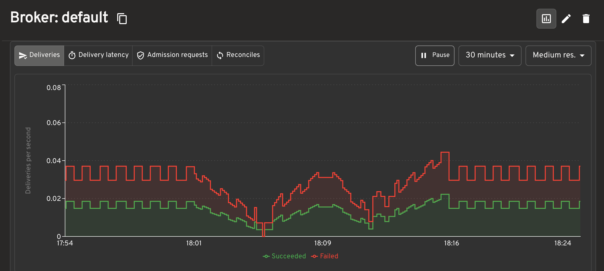
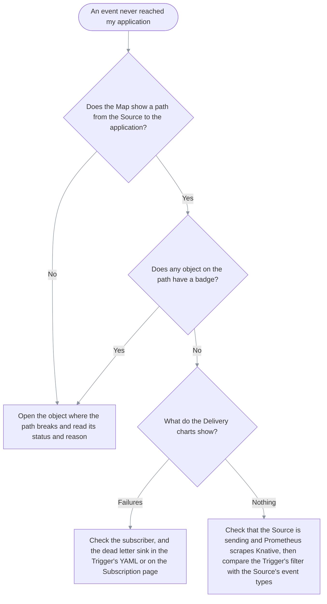
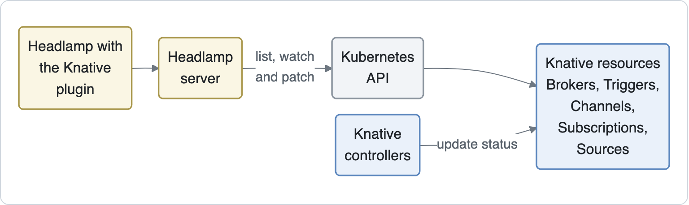

[Knative Eventing](https://knative.dev/docs/eventing/) lets apps on Kubernetes talk to each other
through events. A Source sends them, a Broker collects them, and a Trigger hands each one to the app
that asked for it. Setting it up takes a few short YAML files.

Finding out why an event never arrived is harder. The first time it happened to me, I ran `kubectl
get` on Sources, Brokers, Triggers, Channels and Subscriptions, one kind at a time, and tried to
work out from the YAML how they fit together. Some of those objects I had never created. Knative had
made them for me.

That's what I worked on during my LFX mentorship. The
[Knative plugin for Headlamp](https://github.com/headlamp-k8s/plugins/tree/main/knative) already
covered Knative Serving, as an
[earlier post on the Kubernetes blog](https://kubernetes.io/blog/2026/06/25/headlamp-knative-plugin/)
showed. I added Eventing to it, so you can follow an event in Headlamp and see where it stopped.
Along the way I fixed a few things in Serving, and sent fixes to Knative for bugs in its own metrics.

Not all of this is released yet. [Try it](#try-it), near the end, says what's in the current release
and what ships in the next one.

<!-- truncate -->

## How an event travels

Here's one event going from a PingSource to an app, through a Broker:

*Figure 1. One event's path through a Broker, including the objects Knative creates.*

You create the Source, the Broker and the Trigger. This Broker uses Knative's default class, so
Knative creates a Channel behind it and one Subscription for each Trigger. A Kafka Broker keeps
events in Kafka topics instead and creates neither. An event can stop at any of these objects, so
the plugin gives each one a page and links it to the objects on either side.

## Brokers and Triggers

The plugin adds Brokers, Triggers, Channels, Subscriptions and Sources to Headlamp's sidebar. Every
list shows whether an object is ready, and if it isn't, why. The Brokers list also shows each
Broker's class and the address producers send events to.

A Broker's page links to the ConfigMap that configures it. When a Broker isn't ready, its conditions
say which part failed: the ingress, the filter, the channel behind it, or the dead letter sink.

In the Triggers list, the Trigger dangling-subscriber points to a Service that doesn't exist. You
can see that before opening anything.

Its page shows the filter as you wrote it, the subscriber, and Knative's full message, which names
the missing Service.

The Brokers and Triggers lists also have a create button, if you're allowed to create them. It opens
Headlamp's create dialog with a form next to the YAML editor, and a change in one shows up in the
other. The Trigger form lets you pick the Broker and the subscriber by name, and Apply stays
disabled until the settings pass Knative's own checks.

## Channels and Subscriptions

A Channel's page lists its Subscriptions and whether each one is ready, so you can see which
subscriber is failing.

Remember the objects I had never created? Each Subscription that Knative makes for a Trigger says
which Trigger owns it, along with the Channel it reads from, where it sends events and where replies
go. These pages have no edit or delete buttons. Knative would undo any change, and deleting one by
hand can break the Broker or Trigger that owns it.

## Sources

The Sources list puts every kind of Source in one table. That includes Sources from other projects,
which the plugin finds through the `duck.knative.dev/source=true` label on their
CustomResourceDefinitions. The PingSource missing-sink, for example, is marked Not Ready because
its sink Service doesn't exist.

A Source's page shows its sink, the address Knative resolved it to, and the settings for its kind,
such as a PingSource's schedule or the resources an ApiServerSource watches.

It also lists the type and source of each event the Source sends. Those are the values a Trigger's
filter has to match, so you don't have to guess what to put in the filter.

## Kafka and NATS channels

Knative can carry events over Apache Kafka or NATS JetStream instead of memory. The Channel
Implementations view shows every kind of channel in one table, with the Broker or Channel that
created each one.

A KafkaChannel's page shows how many times a delivery is retried, how long it waits between tries,
the dead letter sink, and the Kafka settings.

## The whole path on the Map

Headlamp's Map draws resources and the links between them, and the plugin adds Eventing to it.
Sources point to their Broker, the Broker to its Triggers, and each Trigger to its subscriber.
Anything that isn't ready gets a badge, so the broken Trigger from earlier shows up as an error
right on the Map.

Filter the Map to one namespace and it shows the Eventing objects in it. Objects that are linked to
each other share a stacked card, and cards that need attention carry a badge. A subscriber or sink
given only as a URI gets no edge, and Sources and channels of kinds the plugin doesn't know, such as
RabbitmqSource, aren't drawn. In both cases the path on the Map stops early even though nothing is
wrong.

Turn on Eventing Internals in the Map's filter and select the card for the Broker default, and the
Map draws Figure 1 with your real objects: the Channel behind the Broker and the Subscription
Knative made for each Trigger. The broken Trigger has none, because Knative only creates the
Subscription after it finds the subscriber.

## Did the events get through?

A Trigger can be Ready while every event sent to it fails. To see what's getting through, the plugin
works with Headlamp's Prometheus plugin and adds charts to the Eventing pages: deliveries that
succeeded or failed, how long they took, events waiting in a queue, and how busy Knative's
controllers are. Which charts a page has depends on the metrics Knative reports for that kind. A
PingSource, for example, has only the controller charts.

Here, one of the Broker's Triggers succeeds on every event and another fails on every event. The
failures are stacked on top of the successes, so neither hides the other.

The queue chart shows when a subscriber falls behind. When I sent 100 events through Kafka to a
subscriber that never answers, the queue went down only as each event ran out of retries.

## When an event goes missing

This is the order I check things in when an event doesn't arrive:

*Figure 2. Where to look, in order, when an event goes missing.*

The broken Trigger from earlier gets caught at the first two checks: it has a badge, and its page
names the missing Service. If everything looks fine but the charts show failures, the subscriber
isn't accepting the events. It answers with errors, or doesn't answer in time. If the Trigger has a
dead letter sink, `status.deadLetterSinkUri` in its YAML shows where those events are sent after
their retries. If the charts show nothing at all, maybe no event got past the Trigger's filter, or
Prometheus isn't scraping Knative. One of the Knative metrics bugs listed below can also leave
deliveries out. Check that the Source is sending, then compare the filter with the event types on
the Source's page.

## Serving got safer too

Before Eventing, I fixed the Serving problems people run into first. Restart used to delete a
Service's Pods. Now it rolls them out the way `kubectl rollout restart` does, so traffic keeps
flowing, and the page follows the rollout until it finishes or fails. This needs Knative 1.21 or
later.

A permission error or a network blip no longer makes the plugin think Knative isn't installed and
hide its pages. Clearing an autoscaling setting now clears it. The check for Knative used to leave a
connection open every time it ran, so six page visits left nineteen connections behind. That fix
ships in the next release.

## Fixing Knative's own numbers

Before trusting any chart, I tested it against a known amount of traffic. Some numbers were wrong:
fifty events through a Broker showed up as a hundred. The bugs were in Knative itself, so I sent the
fixes there:

- [knative/eventing#9606](https://github.com/knative/eventing/pull/9606): the Broker's ingress and
  filter counted every request twice.
- [knative/eventing#9608](https://github.com/knative/eventing/pull/9608): in Knative 1.24,
  PingSource and ApiServerSource metrics stopped saying which Source sent an event.
- [knative/eventing#9610](https://github.com/knative/eventing/pull/9610): the PingSource adapter
  announced its metrics on one port and served them on another, so Prometheus never scraped it.
- [knative/eventing#9612](https://github.com/knative/eventing/pull/9612): an InMemoryChannel counted
  a failed delivery as a success when the dead letter sink took the event.
- [knative-extensions/eventing-kafka-broker#4870](https://github.com/knative-extensions/eventing-kafka-broker/pull/4870):
  the Kafka dispatcher left deliveries that got no answer at all out of its metrics.

These bugs affect anyone who reads Knative's metrics, with or without Headlamp. Some gaps remain. For
example, no Knative component counts events sent to a dead letter sink yet.

## How Headlamp gets the data

The plugin runs inside Headlamp, in your browser or the desktop app. It asks the Headlamp server for
Knative resources, and the server passes each request to the Kubernetes API with your own
permissions. Headlamp watches the lists, so new or changed resources show up without a refresh.
Knative's controllers keep each resource's status up to date, and that status is what the Ready
columns and the Map's badges show. When you click Restart, the request takes the same path, as a
patch to the Service's Deployments.

*Figure 3. How Headlamp gets the data.*

The charts take one more step. Headlamp's Prometheus plugin sends its queries through the same
Kubernetes API to your Prometheus, which scrapes the metrics that Knative's pods report.

## Try it

The Knative plugin in Headlamp's Plugin Catalog is version 0.4.0-beta. It has the Broker and Trigger
lists and pages, the Channel and Subscription lists, the rolling restart and most of the Serving
fixes. The Channel and Subscription pages, Sources, the Kafka and NATS views, the Map, the Broker and
Trigger forms and the charts are merged and ship in the next release. The charts also need the next
release of Headlamp's Prometheus plugin, and a Prometheus that scrapes Knative's metrics, as the
plugin's [README](https://github.com/headlamp-k8s/plugins/tree/main/knative#prometheus-metrics-integration)
describes.

1. Install the [Headlamp desktop app](https://headlamp.dev/docs/latest/installation/desktop/),
   version 0.44 or later.
1. Open the Plugin Catalog in the sidebar and install the Knative plugin. Then reload Headlamp, from
   the notification or with Navigation > Reload.
1. Connect to a cluster that runs Knative, and open Knative in the sidebar.

Headlamp running in a cluster loads plugins another way, described in
[plugin management](https://headlamp.dev/docs/latest/installation/in-cluster/#plugin-management).

To try the merged parts now, build the Knative and Prometheus plugins from main and install them by
hand, as
[Building and Shipping Plugins](https://headlamp.dev/docs/latest/development/plugins/building/#manual-installation)
describes.

The screenshots were taken on a local [kind](https://kind.sigs.k8s.io/) cluster set up with the
plugin's [test files](https://github.com/headlamp-k8s/plugins/tree/main/knative/test-files), which
create healthy and broken versions of the objects shown here.

If something is confusing or missing, please open an issue in the
[Headlamp plugins repository](https://github.com/headlamp-k8s/plugins).

## Thanks

Thank you to my mentors, [René Dudfield](https://github.com/illume) and
[Kahiro](https://github.com/kahirokunn), for careful reviews and for every question that made the
code simpler.
