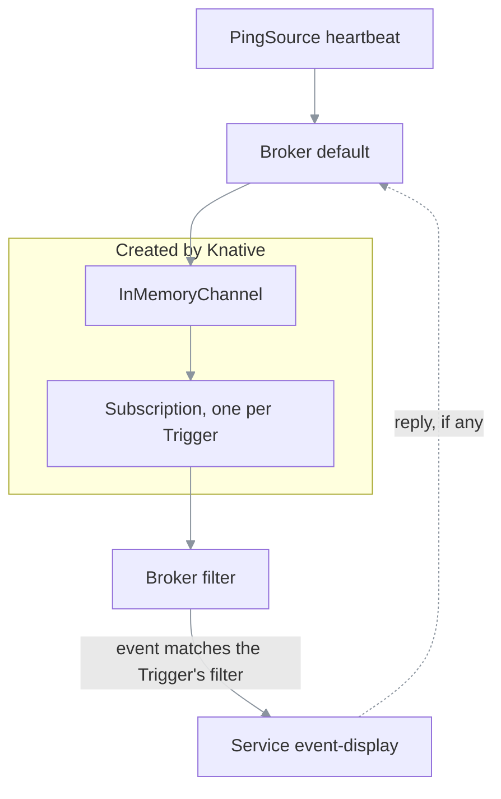
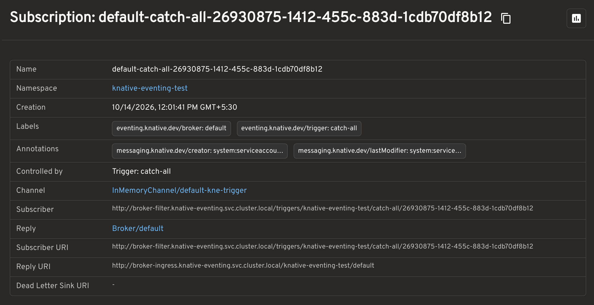

[Knative Eventing](https://knative.dev/docs/eventing/) lets apps on Kubernetes talk to each other
through events. A Source sends them, a Broker collects them, and a Trigger hands each one to the app
that asked for it. Setting it up takes a few short YAML files.

Finding out why an event never arrived is harder. The first time it happened to me, I ran `kubectl
get` on Sources, Brokers, Triggers, Channels and Subscriptions, one kind at a time, and tried to
work out from the YAML how they fit together. Some of those objects I had never created. Knative had
made them for me.

That's what I worked on during my LFX mentorship. The
[Knative plugin for Headlamp](https://github.com/headlamp-k8s/plugins/tree/main/knative) already
covered Knative Serving, as an
[earlier post on the Kubernetes blog](https://kubernetes.io/blog/2026/06/25/headlamp-knative-plugin/)
showed. I added Eventing to it, so you can follow an event in Headlamp and see where it stopped.
Along the way I fixed a few things in Serving, and sent fixes to Knative for bugs in its own metrics.

Not all of this is released yet. [Try it](#try-it), near the end, says what's in the current release
and what ships in the next one.

<!-- truncate -->

## How an event travels

Here's one event going from a PingSource to an app, through a Broker:

*Figure 1. One event's path through a Broker, including the objects Knative creates.*

You create the Source, the Broker and the Trigger. This Broker uses Knative's default class, so
Knative creates a Channel behind it and one Subscription for each Trigger. A Kafka Broker keeps
events in Kafka topics instead and creates neither. An event can stop at any of these objects, so
the plugin gives each one a page and links it to the objects on either side.

## Brokers and Triggers

The plugin adds Brokers, Triggers, Channels, Subscriptions and Sources to Headlamp's sidebar. Every
list shows whether an object is ready, and if it isn't, why. The Brokers list also shows each
Broker's class and the address producers send events to.

A Broker's page links to the ConfigMap that configures it. When a Broker isn't ready, its conditions
say which part failed: the ingress, the filter, the channel behind it, or the dead letter sink.

In the Triggers list, the Trigger dangling-subscriber points to a Service that doesn't exist. You
can see that before opening anything.

Its page shows the filter as you wrote it, the subscriber, and Knative's full message, which names
the missing Service.

The Brokers and Triggers lists also have a create button, if you're allowed to create them. It opens
Headlamp's create dialog with a form next to the YAML editor, and a change in one shows up in the
other. The Trigger form lets you pick the Broker and the subscriber by name, and Apply stays
disabled until the settings pass Knative's own checks.

## Channels and Subscriptions

A Channel's page lists its Subscriptions and whether each one is ready, so you can see which
subscriber is failing.

Remember the objects I had never created? Each Subscription that Knative makes for a Trigger says
which Trigger owns it, along with the Channel it reads from, where it sends events and where replies
go. These pages have no edit or delete buttons. Knative would undo any change, and deleting one by
hand can break the Broker or Trigger that owns it.

