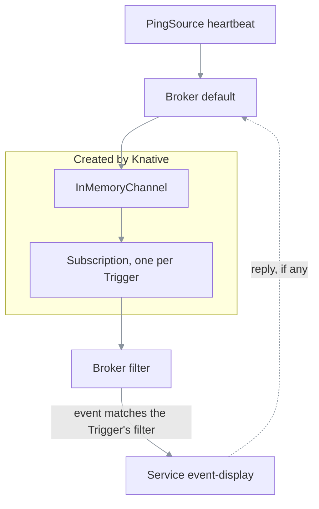

[Knative Eventing](https://knative.dev/docs/eventing/) lets apps on Kubernetes talk to each other
through events. A Source sends them, a Broker collects them, and a Trigger hands each one to the app
that asked for it. Setting it up takes a few short YAML files.

Finding out why an event never arrived is harder. The first time it happened to me, I ran `kubectl
get` on Sources, Brokers, Triggers, Channels and Subscriptions, one kind at a time, and tried to
work out from the YAML how they fit together. Some of those objects I had never created. Knative had
made them for me.

That's what I worked on during my LFX mentorship. The
[Knative plugin for Headlamp](https://github.com/headlamp-k8s/plugins/tree/main/knative) already
covered Knative Serving, as an
[earlier post on the Kubernetes blog](https://kubernetes.io/blog/2026/06/25/headlamp-knative-plugin/)
showed. I added Eventing to it, so you can follow an event in Headlamp and see where it stopped.
Along the way I fixed a few things in Serving, and sent fixes to Knative for bugs in its own metrics.

Not all of this is released yet. [Try it](#try-it), near the end, says what's in the current release
and what ships in the next one.

<!-- truncate -->

## How an event travels

Here's one event going from a PingSource to an app, through a Broker:

*Figure 1. One event's path through a Broker, including the objects Knative creates.*

You create the Source, the Broker and the Trigger. This Broker uses Knative's default class, so
Knative creates a Channel behind it and one Subscription for each Trigger. A Kafka Broker keeps
events in Kafka topics instead and creates neither. An event can stop at any of these objects, so
the plugin gives each one a page and links it to the objects on either side.
